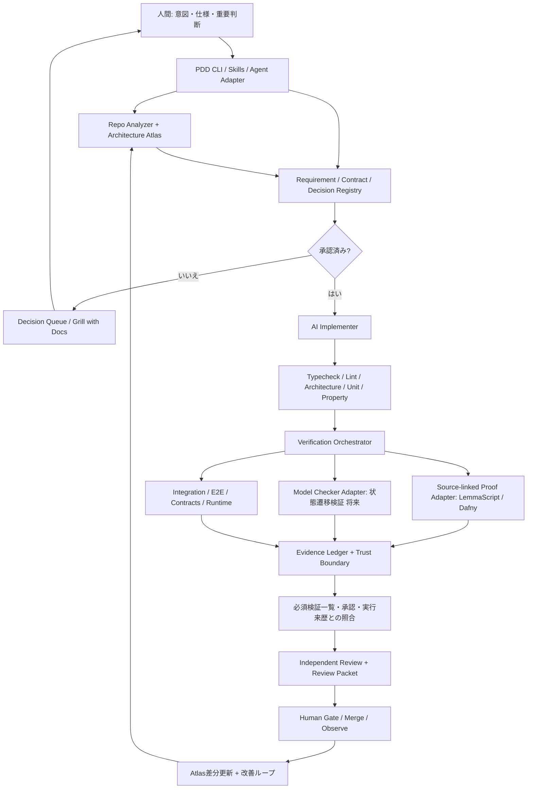
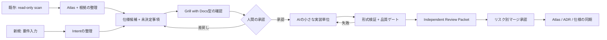

# PDD for TypeScript — 統合実装計画

> **ステータス:** 設計案 / 実装前（2026-11-07、設計レビュー反映版）\
> **仮称:** `pdd-ts`（npm名・商標の空きは未確認）\
> **対象:** 既存・新規のTypeScriptプロジェクト。最初はNode.js上の純粋な業務ロジック、Honoのサンプルを含み、将来的に他のアプリ構成や非同期ワークフローにも拡張\
> **設計の核:** Proof-Driven Development（PDD）× 決定論的品質ゲート × メンタルモデルの維持 × 人間の判断負荷の削減

## 0. エグゼクティブサマリー

**作成動機:** PDD Kitの初期の検証基盤がRust / Verusであることを出発点に、その思想をTypeScriptプロジェクトで利用できるツールを作る。PDD Kitとの思想の重複は意図したものであり、仕様承認・ProofとTestの分離・信頼境界・証跡付きレビューをそのまま継承する。

**目指すもの**は「TypeScriptのコードを全部証明するツール」ではない。**仕様を人間が判断し、AIが実装・証明を進め、機械的な品質ゲートが保証の範囲を明示し、レビュー担当者が重要な判断だけに集中できる開発ワークフロー**である。

- **Proof**：実際のTypeScriptソースを対象とした、条件付きの形式的証明（初期候補はLemmaScript → Dafny → Z3）。
- **Test**：証明対象外の外部I/O、DB、UI、実行時の統合部分はUnit / Property-based / Integration / E2E / 契約テストで検査する。
- **Understand**：Architecture Atlasでシステムの責務・状態・重要フローを把握し、変更時には「メンタルモデルへの差分」を返す。
- **Decide**：曖昧な仕様を、根拠を確認しながら問い直して明確化する。ただしコードで分かることを聞かず、判断カードに集約する。
- **Review**：独立した観点別レビューと、Review Packetの「概要 → 証拠 → 詳細」を統合する。
- **Preserve**：仕様の正本、承認履歴、証明証跡、外部への仮定、ソース・ツールのバージョンをGit/CIで追跡する。

**実装順序:** `実コードの形式検証PoC・既存ツール評価 → 必須検証一覧＋証跡付きCLI＋最小Review Packet → 仕様・承認・CI保護 → 実プロジェクトでの試用・MVP判定 → Atlas自動化 → Skills/AI連携 → 状態遷移検証`。Review PacketはPhase 1から提供し、Atlas全体の自動生成や独自のAI実装ループは試用結果を見て拡張する。

**最初の到達点:** 既存のHonoプロジェクトの純粋関数1つについて、要件IDの付与 → 仕様承認 → ソースからの証明 → 意図的なバグ・検証欠落で不合格 → PRで証拠表示までを完了する。認可boolean関数を接続確認に用い、次に金額配分の保存則など複数の性質を持つ関数で有用性を確認する。同じワークフローを新規の小さなTypeScriptプロジェクトでも動かす。

---

## 1. 参照元と統合方針

### 1.1 ユーザー作成の2つのガイドから継承するもの

| 元資料 | 元資料で重視していた考え方 | 本ツールに取り込む機能 |
|---|---|---|
| **AI主導ソフトウェア開発 導入ガイド** | 「AIが正しいコードを書くことを期待しない。誤りを機械的に検出・修正できる環境を整える」 | Lint / Typecheck / アーキテクチャ制約 / Test / Formal Proofの品質ゲート |
| 同上 | Vertical Slice、Functional Core / Imperative Shell、必要に応じたHexagonal Architecture、State Machine、Modular Monolith | 検証対象の選択、提案されるコード配置、設計リスクの識別。ただし既存プロジェクトに再編を強制しない |
| 同上 | Preconditions / Postconditions / Invariants / Acceptance Criteria をID付きで記録 | 機械可読の要求仕様、検証ケース・証明・テストへのトレーサビリティ |
| 同上 | Unit / Integration / Property-based / E2E / Model-based Testingを分担 | 証明できない領域をテスト等で補完するEvidenceレイヤー |
| 同上 | 実装Agentと独立した検証Agent、安全な権限管理 | AIと独立したプロセスで検証。CI設定・仕様の緩和をレビュー必須にする |
| **AI主導開発における認知負荷削減 導入ガイド** | 判断の総量を減らす・理解コストを下げる・メンタルモデルを維持する・証拠に遡れる | Decision Queue、Architecture Atlas、Evidence付きReview Packet |
| 同上 | 自律判断 / 事後報告 / 事前承認の3分類 | 質問のリスク別トリアージ。低リスクは黙って進め、重要な確認のみまとめる |
| 同上 | Architecture Atlas + 「予測 → 検証 → 修正」 | 既存コードのAs-Is調査、主要3フローと不変条件、変更差分、短い理解確認 |
| 同上 | PRの概要 → 証拠 → 詳細、変更後のメンタルモデル差分 | Review Packet自動生成、リスク別レビュー深度、Atlas更新候補 |
| 同上 | 読解時間・質問回数・中断回数と欠陥見逃しを一緒に測る | 導入前ベースライン、運用KPI、品質低下があれば自動化を見直す |

**整合させる方針:** 2つのガイドは、すべての関数を形式的に検証することを求めていない。既存の品質ゲートとチーム理解を基盤に置き、**影響が大きく、形式化に価値がある箇所だけにProofを追加**する。

### 1.2 作成動機と実際に利用する検証基盤

| 参考 | 確認した主な特徴 | 本ツールでの採用方針 |
|---|---|---|
| **Microsoft Research PDD Kit** | 意図を形式仕様へ落とし込み、証明できる部分はVerus、証明できない境界は明示的な契約とテスト。人間が意図・仮定を確認 | 仕様承認、Proof/Trusted/Testの分離、証明対象外の可視化、CIへの証跡添付を取り込む。Rust固有実装のコピーはしない |
| **LemmaScript** | `//@` 契約付きTypeScriptからDafnyへ変換。TypeScriptが本番コードのまま。`lsc check` / `extract` / `info`等を提供 | 最初の**候補バックエンド**。小規模PoCで忠実性と未対応構文を確かめてから正式採用 |

> MVPの外部検証基盤はLemmaScript / Dafny / Z3。固定バージョン、ライセンス、保証の前提を記録する。PDD Kitは作成動機であり、実行時の依存ではない。

### 1.3 用語の定義

- **Requirement / Intent**：人間が望む業務上の振る舞い。自然言語のままでは証明にならない。
- **Formal Contract**：機械処理可能な事前条件・事後条件・不変条件。
- **Proof Evidence**：指定した前提と数学的意味論のもとで、検証器が条件成立を示した証跡。
- **Trusted Boundary**：検証器が正しさを証明せず、外部契約や実装の正確性を前提にする箇所。
- **Architecture Atlas**：実装の現状（As-Is）に基づく、責務・データ・状態遷移・変更波及のメンタルモデル。
- **Decision Card**：人間に必要な判断だけを、推奨・代替・根拠・影響付きで示す1件の判断単位。
- **Review Packet**：PR変更の概要・証拠・未検証範囲・メンタルモデルの差分をまとめたレビュー用成果物。
- **Evidence**：証明、有限モデル検査、テスト、レビュー、仮定などの総称。**証明とテストを同じ保証と見なさない**。

---

## 2. プロダクトのスコープ

### 2.1 対象ユーザーと利用形態

1. **既存プロジェクト（Brownfield）**：`init`後、コードを読み取り専用で調査し、実装と外部I/Oの境界、検証候補、重要フローを提示。仕様は人間が認めてから追加する。既存ディレクトリの大規模リファクタリングは要求しない。
2. **新規プロジェクト（Greenfield）**：要件から仕様を定義し、必要に応じてVertical Slice / Functional Core / Imperative Shellを提案。仕様を先に承認してからAIが実装・テスト・証明を生成。
3. **段階的導入**：既存機能の一部だけを検証してよい。対象外を「未検証」と正しく表示し、無理な全面適用をしない。

### 2.2 MVPの対応範囲

- 既存の `.ts` を実体として検証できること。独立モデルだけの検査を「実装の証明」と呼ばない。
- Node.js系TypeScript、**純粋関数**、比較・条件分岐・単純なデータ構造を優先。
- `bigint` / 整数演算・コレクションなどは**LemmaScriptの対応表に書かれていても、演算ごとに意味論適合性テストを通したものだけ採用**。
- 浮動小数点`number`、本物の`await`、I/O、DB、ブラウザDOM、未管理の例外・プロキシ等は初期の直接証明対象にしない。
- `if`、リテラルunion、boolean、ループなども、PoCで実例と負例を通過した範囲だけを正式な対応表に載せる。
- エージェント内の自然言語レビューを「形式的証明」と表現しない。
- MVPは、必須検証一覧、契約・要件の参照、承認、CLI、CIゲート、最小Review Packetまで。人間と既存のコーディングAgentで実装を進められることを前提にし、独自のAI実装オーケストレーターは必須にしない。
- Atlasの自動生成、5つのSkill一式、複数Agent対応、独自Contract DSLはポストMVP。PDDの思想と全体構想は維持し、実用性を確認してから機能を増やす。

### 2.3 初期の非目標

- 任意のTypeScript/JavaScriptプログラムの完全な正しさの保証。
- ブラウザUIやブラウザ全体の数学的証明。
- TypeScriptの仕様全体をモデル化する自作SMTソルバー。
- UIダッシュボード、API課金、複数LLMセッション統合の自作を初期の必須条件にすること。
- チームの既存ルール・PRレビューを無条件に置き換えること。

---

## 3. 全体アーキテクチャ



**分離する境界（全体構想。MVPではCLI・Registry・Verifier・CI・Reporterを先に実装）:**

- **Planner / Agent** は仕様案・コード案・証明補助案を作れるが、「証明成功」を決定しない。
- **Verifier** はローカルまたはCIで固定バージョンの検証器を呼び出し、ログ・終了コード・対象の識別子を保管する。
- **Approval** は単なるAI生成JSONのフラグにしない。GitHubの保護されたPR・CODEOWNERSなど、開発者が管理する承認手段で担保する。
- **Policy Gate** は承認済みの必須検証一覧と実行結果を照合する。対象・要件・テストが欠落していれば、残った証拠がすべて成功でも合格にしない。
- **Reporter** は証拠を要約するが、元のログ、生成された証明対象、ソースコードに遡れるようにする。
- **Atlas** は実装のAs-Isに対する説明。To-BeやAIの推測と混同しない。

### 3.1 検証アダプター：保証の種類を型で区別

```ts
export type EvidenceKind =
  | 'source-proof'       // 実ソースと対応づいた証明
  | 'model-check'        // 抽象モデルの状態検査
  | 'test'               // 実行したテスト
  | 'trusted-contract'   // 証明せず依存する契約
  | 'manual-review';     // 人間のレビュー

export type ExecutionStatus =
  | 'passed'
  | 'failed'
  | 'unsupported'
  | 'unknown'
  | 'not-run'
  | 'stale'
  | 'error';

export interface EvidenceRecord {
  id: string;
  requirementIds: string[];
  obligationId: string;       // 必須検証一覧のどの項目に対応するか
  kind: EvidenceKind;
  status: ExecutionStatus;
  scope: string;               // 証明/検査の正確な対象
  assumptions: string[];       // 証明で前提にした条件
  verifiedSymbols: string[];   // 実際に検証された関数
  verifiedContractIds: string[]; // 実際に検証された契約
  premiseEvidenceIds: string[]; // 入力条件成立・前提充足の根拠
  artifactPaths: string[];     // ログ、モデル、生成物等
  artifactDigests: Record<string, string>; // 証明追加ファイルも含む内容の指紋
  proofInputDigest: string;    // 実際に検証器へ渡した全入力の指紋
  sourceDigest: string;        // ソース + 検証対象依存の指紋
  specDigest: string;          // 承認済み仕様の指紋
  toolchainDigest: string;     // ツール/設定/意味論バージョン
  commit: string;             // 実際に検査したcheckoutのコミット
  run: {
    id: string;
    origin: 'local' | 'ci';
    workflowIdentity?: string;
    url?: string;
  };                          // 記入値だけで信頼せず、CI側で実行来歴を確認
}

export interface VerificationAdapter {
  id: string;
  analyze(target: string): Promise<{
    supported: boolean;
    reasons: string[];
  }>;
  verify(target: string): Promise<EvidenceRecord[]>;
}
```

**実装時のルール:** `passed` だけを見て「Proof成功」と表示しない。`kind`、`scope`、`assumptions`、生成物、元ソースへの対応確認も必要。`unknown` / `unsupported` / `stale` は成功に昇格させない。結果に、検証対象内の関数と証明されていない呼び出し先も含める。`trusted-contract`の確認や人間の承認は`source-proof`を代替しない。履歴の中から都合のよい成功を選ばず、評価する実行・対象ソース・仕様を固定して判定する。

#### 必須検証一覧（Verification Obligations）

Phase 1から`.pdd/obligations.yaml`に、各要件に必要な契約ID、関数、検証種別、必須テスト、入力境界の確認、仮定監査を列挙する。これは実行結果から後付けで作る一覧ではなく、要求する証拠の一覧である。Phase 1は未承認の試行用、Phase 2以降は承認済みの基準として扱う。

- `obligationId`ごとに、対象・契約・種別・鮮度・実行来歴・必要な承認を照合する。単なるレコード件数やプロセスの終了コードでは判定しない。
- 要件・関数・契約・テスト・対象リストの削除、対象変更、skip、実行0件、結果ファイルの欠落を検出する。必要な証拠がない場合はゲート不合格にする。
- 一覧の変更・削除自体も保護する。PR側だけの一覧を正本とせず、保護された既存基準とのdiffと明示承認によって追加・改訂・廃止する。
- 未検証範囲を表示することと、必須検証を免除することを分ける。免除には対象・理由・承認者・期限を記録し、`passed`へ変換しない。期限切れは不合格。
- **合格条件は、承認済みの必須検証がすべて満たされ、必要な証拠が欠けていないこと。** 初期導入の未承認状態は試行結果として表示し、保護されたCIゲートの合格とは扱わない。

### 3.2 Proof Boundaryの4層

| 層 | 例 | 提供する保証 | MVP |
|---|---|---|---|
| A: Source-linked formal proof | 純粋関数の事後条件 | 指定条件と意味論のもとでの形式的証明 | 必須 |
| B: Bounded model checking | 重複ジョブの同時実行 | 指定した有限の状態・ステップで反例がない | 将来 |
| C: Empirical evidence | DB連携、パスワード検証、HTTP、UI | 実行したケースについてのテスト結果 | 必須 |
| D: Trusted / Unverified | 外部APIの返値、クロック、仕様外の例外 | **証明による保証なし** | 必須（必ず明示） |

MVPの表示では、たとえば `Proof passed (2 requirements; 3 assumptions)` と明示し、単一の「安全率」など誤解を生む数値に変換しない。Proofの結果と、全必須検証を満たしたかというゲート結果は別に表示する。

### 3.3 入力条件と呼び出し元への保証の接続

純粋関数の証明は、その事前条件を満たす入力についての保証である。TypeScriptの型だけでHTTP入力、`any`、型アサーション、外部ライブラリ由来の値が条件を満たすとは扱わない。

契約ごとに、呼び出し元で前提が成立する根拠を、**検証済み呼び出し元 / 実行時バリデーション / 実行したテスト / 承認済みの仮定 / 未確認**に分類してEvidenceへ接続する。テストと承認済みの仮定をProofへ昇格させない。

- 検証済みの呼び出し元では、calleeの事前条件が証明義務になっていることを確認する。
- 未検証のI/O境界では、実際に通るバリデーション・変換処理とテストを参照する。構文上validatorが存在するだけでは保証しない。
- 高リスクな境界の条件が未確認なら、関数単体のProofが成功しても、エンドツーエンドの要件達成として合格させない。
- 新しい呼び出し元・バイパス経路・validator変更では、この接続の再確認を要求する。MVPでは対象フローを明示登録し、網羅できない動的な呼び出しを自動で解決したとは扱わない。

---

## 4. ファイルと情報の正本（Single Source of Truth）

**重複ドキュメントを増やさないためのルール:** 自然言語の意図・要件IDは`.pdd/requirements/`、形式契約はTypeScriptソース内の`//@`アノテーション、必須検証一覧は`.pdd/obligations.yaml`を正本にする。名称は`CONTEXT.md`、アーキテクチャ事実はAtlas、判断の理由はADR、実行証拠は`.pdd/evidence/`に保存する。抽出された契約スナップショットとReview Packetは**読み取り専用の生成物**であり、編集する仕様の正本にしない。以下は拡張後の全体配置であり、MVPの`init`でAtlasやSkillの空ファイルを一括生成しない。

```text
project/
├── AGENTS.md / CLAUDE.md             # Agent向け最小限のルール・Skillルーティング
├── CONTEXT.md                        # ドメイン用語と避ける曖昧語
├── docs/
│   ├── architecture/
│   │   ├── overview.md               # Context / Container、責務の概要（約1ページ）
│   │   ├── domain-map.md             # 主要概念と機能境界
│   │   ├── runtime-flows.md          # 重要3フロー：正常・異常
│   │   ├── state-invariants.md       # 業務の不変条件・復旧条件
│   │   └── change-map.md             # 影響の波及境界
│   └── adr/                           # 重要な決定の背景（追加・改訂履歴）
├── .pdd/
│   ├── config.yaml
│   ├── obligations.yaml               # 必須の証拠・対象・例外（保護対象）
│   ├── requirements/                  # 要件ID・自然言語の意図・契約への参照
│   ├── decisions/                     # 人間に確認すべき判断・回答履歴
│   ├── approvals/                     # 人間の承認と紐付くPR/コミット
│   ├── boundaries/                    # 外部I/O・信頼する契約
│   ├── evidence/                      # 実行結果・再現情報（機密は除く）
│   └── reports/                       # Review Packetの生成物
├── .claude/skills/                    # Claude CodeのプロジェクトSkills（利用時のみ）
├── .agents/skills/                    # その他のエージェントに必要ならアダプター
└── src/                                # 元のプロジェクト構造を保持
```

### 4.1 要件と形式契約の正本（独自DSLは延期）

以下のYAMLはpdd-tsが管理するメタデータ案であり、LemmaScriptの既存仕様ではない。形式式をYAMLとソースの両方へ手書きしない。

```yaml
id: AUTH-001
revision: 1
title: 管理者トークン発行可否
intent: 管理者かつ認証成功の場合に限り発行可否をtrueとする
risk: high
target:
  file: src/domain/auth.ts
  symbol: canIssueAdminToken
contracts:
  - id: AUTH-001-C1
    kind: postcondition
    human: 返値は管理者かつ認証成功であることと同値
    sourceRef:
      file: src/domain/auth.ts
      symbol: canIssueAdminToken
      clause: ensures
      index: 0
    semantics: boolean-and-string-literal-v1
acceptance:
  - id: AUTH-001-T1
    kind: integration-test
    scenario: 認証境界から渡される値が契約に合うこと
trustedBoundaries:
  - passwordVerification
  - roleLookup
```

契約の正本は次のようにソースへ置く。`sourceRef`は行番号ではなく、関数と抽出した契約節への参照として解決する。参照不一致・曖昧さ・節の追加削除は黙って別の式へ結び直さず、diffと再承認の対象にする。

```ts
//@ contract 管理者かつ認証成功の場合に限り発行可否をtrueとする
//@ ensures \result === (role === "admin" && passwordOk)
export function canIssueAdminToken(
  role: "admin" | "user",
  passwordOk: boolean,
): boolean {
  return role === "admin" && passwordOk;
}
```

- `lsc extract` / `lsc info`で形式契約を抽出する。対象関数の**全契約節**と型・意味論を承認スナップショットへ含め、参照された節だけを承認対象にしない。
- 独自Contract DSLとバックエンド共通IRはMVPでは作らない。複数バックエンドで必要性を確認したときにADRで判断する。
- 自然言語と形式契約の意味の一致は完全には自動保証できない。インタビュー、シナリオ、Mutation Testing、独立レビューで補強する。
- 承認対象は要求ID・revision・抽出した全契約・入力条件・例外・仮定・意味論・必須検証一覧・免除を含む。これらから仕様のダイジェストを計算する。
- 初期は意味的な強化／弱化の自動判定を合格の根拠にしない。**契約または前提が変わったら再承認**を要求する。差分説明は補助であり、意味的に同等と証明できない変更を自動承認しない。
- `.pdd/approvals/`には外部の承認ID、承認者、仕様ダイジェスト、対象revisionを記録する。ローカルの`approval.state`やAIが書いた承認ファイルだけで承認済みと扱わず、CI側で外部承認と照合する。

### 4.2 証跡の鮮度

証明結果の鮮度を判定する指紋は、**対象ファイルだけでは不十分**。関連するimport、型定義、契約・仮定、必須検証一覧、入力境界、生成IR、実際に渡したDafnyファイル、手書きの証明追加・ghost定義、変換器・証明器・オプション・構成・依存の固定情報を含む。収集できない依存があれば、保守的に`stale` / `unknown`にする。

ダイジェストは内容の一致を示すもので、検証を実行した証明ではない。ローカル結果と保護されたCI結果を区別し、CIでは対象checkout、入力ダイジェスト、実行ID、workflowの識別子と取得元を照合する。作業ツリーに未コミット差分があるローカル結果は、その差分を含むソースダイジェストを記録し、同じコミットのCI結果として再利用しない。

---

## 5. ワークフロー：新規と既存が合流する地点

以下は全体構想。MVPでは要件・対象フロー・判断事項を人間と既存のAgentで明示登録し、`scan`・Atlas自動化・専用の`plan` / `implement` / `review`連携はPhase 4以降で追加する。



### 5.1 `scan`：まずコードを読み、分かることは人間に聞かない

- README、package.json、tsconfig、import graph、エントリポイント、API、DB/外部I/Oの境界、テスト、CI、変更頻度の高い領域を調査。
- `Architecture Atlas`をAs-Isとして生成。**確認済み / 推測 / 未確認**を分離し、各図に根拠ファイルパスを付ける。
- 最初は重要な3フローの正常・異常パターンを記述。`state-invariants.md`は要件・契約への候補リンクを持つ。
- リスクの高い純粋関数を候補にする。外部依存・未対応構文・数値意味論などは適合性判定で理由を出す。
- 既存コードがそう振る舞うことと「その振る舞いが正しい仕様であること」を混同しない。

### 5.2 `plan`：根拠に基づく要求仕様レビュー

1. `CONTEXT.md`とAtlas/ADR/既存仕様を参照し、用語の衝突・未決定の責務・境界条件を抽出。
2. 質問を**事実確認 / AIが規約で決定可能 / 人間が所有する仕様判断**に分解する。
3. 事実確認は先にコードやテストから解決。明示されていない要件や不可逆な判断だけを人間へ質問する。
4. 同じ機能の非ブロッキングな確認は1枚のDecision Cardに束ねる。重要な阻害要因は即時に止める。
5. 重要な用語の決定は`CONTEXT.md`、持続する設計判断は`docs/adr/`に記録。どうでもよい議論を文書化しない。
6. 仕様候補に前提・事後条件・不変条件・受け入れ条件・例外・認可境界・Trusted Boundaryを記述。
7. 人間が承認した仕様だけを次の工程へ進める。未決事項は`OPEN`として残してよいが、その論点に依存する実装・証明は開始しない。

#### Decision Cardの標準形式

```md
### 決定: AUTH-001 — トークン発行に必要な認証状態
- 推奨: 管理者権限かつ直近の認証成功を要求
- 代替: 管理者権限のみを要求（利便性は高いがリスクが大きい）
- 影響: 認可境界、ログインフロー、既存トークンの扱い
- 未確認: 認証成功の有効期間、失効ポリシー
- 根拠: src/domain/auth.ts、docs/architecture/runtime-flows.md
- 期限/ブロッカー: 本機能の仕様承認前に決定が必要
```

### 5.3 質問と判断を3段階に分ける

| 区分 | 判断基準 | 動作 |
|---|---|---|
| 自律判断 | 規約で決まる、局所的・可逆・低影響 | 質問しない。必要ならログ記録 |
| 事後報告 | 複数案があるが低リスクで変更可能 | 推奨案を採用し、まとめて報告 |
| 事前承認 | 仕様、認可、課金、データ削除、外部送信、不可逆・高影響 | Decision Cardを提示し、承認まで停止 |

**AIの確信度は承認不要の根拠にしない。** 影響・可逆性・検証可能性に基づいて決める。

### 5.4 `implement`・`verify`：検証可能な小単位

- AIは仕様を小さなSlice / Ticketに分ける。各チケットは受け入れ条件、依存関係、変更対象、検証コマンド、停止条件を持つ。
- 独立な作業はGit worktreeで並行化可能。ただし共有DB/schema/仕様正本の更新は競合制御し、合流は一度に1つずつ。
- 各チケットで `Typecheck → Lint → Architecture rules → Unit/Property → 前提・仮定監査 → Source-proof → Integration/E2E（必要時） → 必須検証一覧との照合` を実行。
- 失敗時はAIが原因を調べ、承認仕様を弱めずに修正。予算・試行回数の上限で停止し、結果を人間へエスカレーション。
- 独立した検証Agentを利用する場合は、実装Agentと役割を分離し、承認済み仕様・実コード・実行証拠から評価する。**検証AgentのコメントもProofではない**。MVPでは固定CLIとCIによる独立検証を必須にし、複数Agentの起動や独自実装ループは必須にしない。
- 反例が見つかれば、再現可能な最小入力・状態・手順に変換し、テストへ回収する。

### 5.5 `review`：Review Packet生成

**表示の順序は「30秒サマリー → 検証の証拠 → 危険な箇所の詳細」**。Phase 1からMarkdown/JSONの最小版を生成し、Phase 2で承認・CIの状態を接続する。Atlasの自動生成やAgent連携が完成するまで待たない。

```md
# PR Review Packet: #123 トークン発行条件

## 30秒サマリー
- 目的: AUTH-001を満たす
- 振る舞いの変化: 管理者でも認証未成功なら発行不可
- リスク: 高（認可境界の変更）
- 判断待ち: 既存トークン失効方針の承認

## 変更範囲
- Domain: src/domain/auth.ts
- Boundary: src/routes/token.ts
- 影響: ログインとトークン発行

## Evidence
| 要件 | 種類 | 結果 | 対象/前提 | 根拠 |
|---|---|---|---|---|
| AUTH-001-C1 | Source-proof | Passed | 認可純粋関数 | proof.log |
| AUTH-001-T1 | Integration | Passed | Test DB | ci-job-url |
| AUTH-001 | Trusted | Reviewed assumption | passwordVerification | contract-url |

## ゲート判定
- 結果: BLOCKED（関数単体のProof結果とは別）
- 必須検証: 充足2件 / 欠落1件（認証有効期間の境界テスト）
- 承認: AUTH-001 revision 2 / specDigest / 外部承認へのリンク
- 実行: 検証したcommit / sourceDigest / CI runへのリンク
- 保証の変化: 純粋関数の条件は維持、呼び出し境界の未確定事項あり

## 未検証・注意点
- 既存トークンの権限失効は要件未確定
- 実際の認証APIが契約どおりに振る舞うかは統合テストに依存

## メンタルモデルへの差分
- 不変: ドメイン境界
- 変更: トークン発行の許可条件
- 新規: 認証有効期間という概念
- Atlas更新: runtime-flows.md

## 詳細
- PR Diff / 承認済み仕様 / 証明器ログ / テスト / 影響図
```

- 低リスクPRは要約とCI中心、高リスクPRは仕様・脅威・状態遷移・主要Diffまでレビューする。
- ダッシュボードは初期に作らず、GitHub PRコメントとMarkdown/JSONで開始する。

### 5.6 `merge`後：メンタルモデルの理解ループ

- Atlasを変更差分で更新し、全面的に作り直さない。
- 新領域・高リスクPRでは「このAPIがタイムアウトしたらどの状態が残る？」など**1問だけ**予測 → コード・テストと答え合わせ → 必要な箇所を修正。
- 本番の障害・ユーザーからの不具合を要件、契約、テスト、境界の見直しに戻す。

---

## 6. Skills設計：コピーではなく機能の合成

### 6.1 責務の分離

| 責務 | pdd-tsが提供する機能 |
|---|---|
| 調査 | コードへの参照を付けたAs-Isの把握とAtlas更新 |
| 仕様整理 | 未決定事項の判断カード、用語、ADR、契約と要件の対応付け |
| 実装 | 承認済み仕様を保ちながら、小単位で修正・テストする手順 |
| 検証 | 固定CLIによる再実行、保証範囲・前提・鮮度・欠落の確認 |
| レビュー | 実際の証拠に基づくReview Packetとメンタルモデル差分 |
| 改善 | 失敗原因をテスト・仕様・ゲート・ADRへ反映 |

### 6.2 ポストMVPのプロジェクトローカルSkillの最小セット

```text
.claude/skills/
├── pdd-intake/SKILL.md       # 既存コード調査、証拠付きAtlas、検証候補
├── pdd-plan/SKILL.md         # 仕様インタビュー、Decision Card、ADR/用語更新
├── pdd-implement/SKILL.md    # 承認仕様を変更せず小単位で実装・修正
├── pdd-verify/SKILL.md       # CLIによる独立検証と証跡の解釈
└── pdd-review/SKILL.md       # リスク別Review Packet + Atlas差分
```

- `SKILL.md`には `name` / `description` を含むフロントマター、いつ呼ぶか、**入力条件、読み取る正本、禁止事項、呼び出すCLI、生成成果物、完了条件**を明記。
- Claude CodeとCodexの両方で利用できるよう、**ツール固有のSkill配置・実行方法はAgent Adapterで扱う**。`SKILL.md`が存在するだけで、どのエージェントでも自動実行されるとは仮定しない。
- AGENTS.md / CLAUDE.mdには短い共通規則だけを残す。詳細手順を全セッションへ常時注入しない（認知・トークン負荷を抑える）。

#### Agent用ルールの最小テンプレート

```md
## PDD rules
- 承認済みのrequires / ensures / invariants / acceptanceを弱めない。
- 低リスクで可逆な判断は規約に沿って実行し、必要なら記録する。
- 高リスク・仕様不明の判断のみDecision Cardで確認する。
- Proof / Model Check / Test / Trusted Boundary / Unverifiedを混同しない。
- 変更したコードに対応する必須検証を実行し、実際の終了コード・ログを提示する。
- 失敗を隠すテスト削除・条件緩和・CIのスキップはしない。
- 図・要約は証拠とセットにする。高リスク時は主要Diffを確認できるようにする。
- 本番環境への送信・データ変更・不可逆操作は別途明示承認を必要とする。
```

---

## 7. CLI・パッケージ設計

以下は**新規に実装するCLIの全体案**であり、現時点で利用可能なコマンドではない。MVPでは`init` / `doctor` / `verify` / `report` / `approve` / `audit`を優先し、`plan` / `scan` / `review`の専用コマンドと高度な変更対象選択は試用後に追加する。最小Review Packetは`report`で出せるようにする。

```bash
pdd-ts init                    # 設定と既存構成を検出。勝手に再編しない
pdd-ts doctor                  # ツールチェーン・バージョン・権限・依存診断
pdd-ts scan --read-only        # As-Is / 境界 / 検証候補 / Atlas差分案
pdd-ts plan --target auth      # 仕様候補 + 人間の判断待ち
pdd-ts approve AUTH-001        # 外部の承認証跡と仕様revisionを紐付け
pdd-ts verify                  # MVP: 登録された全必須対象のProof + 品質ゲート
pdd-ts verify --changed        # 将来: 依存の取りこぼしを防げる場合のみ選択実行
pdd-ts test --scope changed    # テストEvidenceの取得
pdd-ts review --pr 123         # Review Packetの生成
pdd-ts report --json           # 機械可読な証跡
pdd-ts audit                   # 仕様/コード/信頼境界/証跡の不一致を検出
```

### 7.1 初期は単一パッケージ、内部モジュールで責務を分離

```text
pdd-ts/
├── package.json
├── src/
│   ├── cli/                   # 引数・exit code・doctor
│   ├── requirements/          # 要件・契約参照・承認・必須検証一覧
│   ├── verification/          # Evidence・照合・鮮度・入力境界
│   │   └── lemmascript/       # CLI呼び出し・生成物・仮定監査
│   ├── ci/                    # 実行来歴・承認照合・ポリシー保護
│   └── reporter/              # 最小Review Packet・JSON
├── examples/
│   ├── existing-hono/
│   ├── greenfield-domain/
│   └── negative-cases/
├── tests/
│   ├── conformance/
│   ├── mutations/
│   ├── integration/
│   └── e2e-cli/
└── docs/
    ├── adr/
    ├── design/
    └── runbooks/
```

**技術選定:** TypeScript / Node.js、pnpm、TypeScript Compiler APIまたはts-morph（既存の抽出結果で不足する範囲だけ）、Zod、Vitest、fast-check、GitHub Actions。UI検査の依存は実際に必要になった段階で導入する。初期Proof候補はLemmaScript + Dafny + Z3。

初期から複数の公開パッケージや専用のビルド管理基盤を必須にしない。Atlas、Agent Adapter、複数の検証バックエンドに独立した利用・リリース要件が生じたら、内部境界を使ってパッケージを分割する。将来のモデル検査には適切な状態遷移検証器を検討する。

**外部ツールの実行:** `child_process`等で引数配列を使って起動し、シェル文字列の組み立てを避ける。タイムアウト・最大出力サイズ・リソース上限・終了コード・ツールバージョン・ログの機密情報除去を実装する。権限のない本番環境にはアクセスしない。実行対象のコード・依存インストール・テストも未信頼のコード実行として扱う。

**利用する検証基盤:** LemmaScriptの公開CLIとDafnyを直接利用する。対応範囲、入出力、実行権限、固定バージョン、ライセンスを記録し、不足する要件・承認・証跡・ゲートをpdd-tsで実装する。

### 7.2 LemmaScriptの導入時に確かめること

- `lsc check --backend=dafny <file.ts>` 等の公開CLIをPoCで動かす。`lsc extract` / `lsc info`を利用し、対応構文・契約とソースを追跡する。
- 変換器が対象関数を**削除・無視・公理化**していないか検出する。生成されたIR/証明用コードと対応範囲をレポートに含める。
- LemmaScriptが`number`へ与える数学的意味論は、IEEE 754のJavaScript Numberと同等とは限らない。`bigint`も除算など実際の演算意味論を個別に検査する。
- `null`と`undefined`を同一視するなど、モデルが実行時と異なる箇所は対象から外すか、前提を明示する。
- 真の`await`には非対応。分散・非同期処理の安全性は実コードの証明とは別のモデル検査へ送る。
- ストリングのUTF-16/Unicodeスカラー設定、配列境界、例外、NaN、オブジェクトのエイリアス、型アサーション、外部関数の仮定をテスト。
- LemmaScriptのバージョン・バックエンド・設定ごとの実測対応表を`docs/compatibility.md`で管理する。
- Dafnyの生成基準ファイルと実際の証明追加ファイルを区別する。追加差分だけでも未証明の仮定や検証回避を導入できるため、additions-onlyの確認だけで合格にしない。
- 適合性テストが通っても、翻訳器の一般的な意味保存の証明が得られたとは扱わない。変換器・バックエンド・対応サブセット・実行環境を、信頼する基盤（TCB: Trusted Computing Base）と前提の一覧に含める。
- PoCが成立しなければLemmaScriptを固定前提とせず、対応範囲の縮小か別のバックエンドをADRで判断する。独自IRの導入はMVPの救済策にせず、必要性と保守負荷を評価する将来の判断に分ける。

---

## 8. 検証・セキュリティ・品質ゲート

### 8.1 多層のゲート

| 実行タイミング | 必須ゲート | 実行方針 |
|---|---|---|
| 実装中 | Typecheck、Lint、Unit / Property（変更対象） | 高速、繰り返し可能 |
| 対象の契約変更時 | Contract構文チェック、仕様承認、Source-proof | 証明・意味論・前提を検査 |
| PR | Architecture rules、Unit / Property、Integration / Critical E2E、Proof、機密検査、Review Packet | リスクで検査深度を変える。必須条件はスキップ不可 |
| 定期 | 全E2E、Model Check（対応後）、依存関係スキャン、証拠の鮮度再検査 | 変更外の劣化も検出 |

**ゲート保護:** GitHubのbranch protection / rulesets / CODEOWNERS等を使い、仕様、必須検証一覧、免除、CI設定、検証用アダプター、必須テスト、`trustedBoundaries`の変更には適切な人間のレビューを要求する。具体的な成立条件は§8.5に定め、`doctor`で設定不足・確認不能を報告する。

### 8.2 脅威モデルと失敗時の動作

| 想定される事故 | 防御策 | 受け入れ試験 |
|---|---|---|
| AIが仕様を弱める / 事前条件を強める | 契約・前提の変更時に再承認、保護された既存基準とのdiff | 未承認の仕様変更でCI失敗 |
| 要件・テスト・対象一覧を削除して全成功に見せる | 必須検証一覧との照合と一覧自体の保護 | 検証0件・skip・削除・欠落でCI失敗 |
| 矛盾した前提や証明追加で見せかけの成功を得る | 前提充足・代表シナリオ・未証明仮定の監査 | `requires false`・未承認の`assume false`を不合格 |
| 翻訳器がコードを誤ってモデル化する | 対応サブセット限定、正負の適合性テスト、生成IRの追跡 | Numberやnullの差でProof成功を出さない |
| Proof対象と本番実装が違う | source hash、関数のimport/call graph、対象モジュールの確認 | 本番から未検証の別実装を使うと警告 |
| 未検証の外部関数を暗黙の公理として扱う | Trusted Boundary台帳、前提の承認、契約テスト | 仮定を増やすと再承認が発生 |
| `unknown` / timeout / unsupportedを成功と見なす | fail-closedの型付けとCI exit code | すべての失敗種別が明示される |
| 昔の証明結果を再利用する | ソース・依存・仕様・証明追加・ツールの指紋と実行来歴 | 依存・証明追加だけ変えてもstale、偽のCI結果は拒否 |
| CIや承認記録をPR内で差し替える | 信頼するworkflow・チェック発行元・外部承認との照合 | 同名の偽チェック・改ざん承認・未承認ポリシー変更で不合格 |
| 関数の事前条件を満たさない経路から呼ぶ | 呼び出し元または実行時バリデーションへのEvidence接続 | 新規の未確認バイパス経路では要件達成と表示しない |
| AIがログ・README内の悪意ある指示に従う | 読んだコード/ドキュメントを未信頼データ扱い。権限とサンドボックス | Prompt injectionを含むfixturesで外部送信なし |
| UIの検査で本番へ送信する | テスト環境、dry-runの副作用実測、ネットワーク制限 | テスト実行で本番データ不変 |
| 仕様の不足をProofで隠す | 受け入れシナリオ、反例、Mutation Testing、第三者レビュー | 弱い仕様が検出・報告される |

### 8.3 Proofの品質を確認するための負例

1. 正しい関数・充足可能な前提・必要な検証一覧 → 条件付きの形式検証成功。
2. 明らかに不正な返値へ変更 → 証明失敗または反例。
3. 返値を固定する退化実装 → 仕様に反する改変は検出。生き残ったMutationは仕様不足・同値変異等を調査し、Mutationだけで仕様完全性を主張しない。
4. 非対応の`await`や浮動小数点演算 → **未対応**とする。
5. 到達可能な入力で成立しない事後条件 → 証明失敗。**事前条件の矛盾では証明が通り得る**ため、別の前提健全性ゲートで不合格にする。
6. 認可の外部依存や証明ファイルに未承認の仮定を追加 → **未承認の仮定**とする。
7. 証明後に依存する型・コード・設定・証明追加ファイルを変更 → **stale**とする。
8. `lsc` / Dafnyのプロセスがタイムアウト → **unknown/error**で落とす。
9. 必須の要件・関数・契約・テスト・対象一覧を削除、skip、実行0件 → 残りが成功でもゲート不合格。
10. 古い承認の流用、結果JSONの偽造、同名の別発行元チェック → 保護されたCI結果として受け入れない。
11. 呼び出し元が入力条件を満たさない、または未確認のバイパスを追加 → 関数のProofと区別し、該当要件のゲートを不合格にする。

### 8.4 前提の健全性と証明追加の監査

`requires x > 0 && x < 0`のような矛盾した前提は、該当入力が存在しないため、任意の事後条件について検証成功を生み得る。Proof成功だけでは前提の妥当性を示さない。

- 各対象で前提を満たす入力の存在を確認する。MVPでは承認済みの具体的な入力例を、対応する意味論で評価して根拠にできる。必要なら充足可能性を問い合わせ、`unknown`を充足と扱わない。
- 承認済みの正常・異常・境界シナリオが意図せず前提から除外されていないかを検査する。意図的に空の領域を扱う場合は、その目的を明示し通常の業務機能の保証と区別して承認する。
- Dafnyの`assume`、公理、検証省略、未証明の外部契約等を抽出し、承認済みの仮定と照合する。`dafny audit`は補助に利用し、固定バージョンで監査範囲を確認する。監査に含まれない回避手段も別途検査する。
- **`dafny audit`は指摘があっても終了コード0を返し得る。** 出力の指摘と承認済み一覧のdiffを判定し、未承認・解析不能・出力欠落は合格にしない。
- 手書きの証明追加、ghost定義、生成コード、検証オプションを同じ監査・鮮度判定の範囲に含める。AIによる補助証明も例外にしない。

### 8.5 承認・CI・実行来歴の成立条件

1. **承認の対象固定:** 外部の人間承認を、要件revisionと仕様ダイジェストに結び付ける。PR承認後に契約・前提・必須検証・免除が変わったら再承認する。PRへのリンクだけでは承認としない。
2. **基準の保護:** CIの判定ロジック・必須検証一覧・承認照合ルールは、保護された基準版を使う。同じPRでゲートを緩め、その緩めたゲート自身で変更を承認させない。正当な更新も既存ルールに基づく承認を経て適用する。
3. **実行対象の固定:** 実際に検証したcheckoutのコミット・ソース・仕様・証明入力を記録する。PR headとマージ候補は区別し、対象が変わったら必要な検証をやり直す。
4. **発行元の確認:** 必須ステータスチェックは信頼する発行元に結び付け、保護されたworkflowの実行来歴と成果物を照合する。署名やattestationを使う場合も、署名の存在だけでなく発行元・対象・入力を確認する。ローカルの自己申告JSONをCI合格として採用しない。
5. **権限分離:** 未信頼のPRコード・依存インストール・テストは、書き込み権限や機密を渡さない実行環境で扱う。PRコメント等の書き込みは別jobで、来歴を確認した構造化データだけを消費する。特権workflowで未信頼コードを実行しない。
6. **導入診断:** `doctor`は必要なレビュー、古い承認の失効、CODEOWNERS、チェック発行元、保護の迂回設定等を、取得できる範囲で読み取り確認する。不足・権限不足・確認不能は区別し、確認できない状態で「CI保護済み」と表示しない。設定変更は導入手順として示す。

---

## 9. 実装ロードマップ（依存関係・成果物・完了条件）

> 期限はチームの稼働量次第。段階ごとに動く縦断スライスを完成させる。MVPリリース判定はPhase 3。Phase 4以降はPDDの全体構想として維持し、試用で必要性を確認して拡張する。

### Phase 0 — 技術適合性と既存ツールの評価

**成果物:** `docs/compatibility.md`、正負のfixtures、ADR-0001（検証エンジン・再利用方針）、代表的な業務関数、評価ベースライン。

- [ ] LemmaScript / Dafny / Z3と関連ツールのバージョン・導入方法・ライセンスを記録し、再現可能な構成を固定する。
- [ ] boolean・文字列リテラル・分岐の正負例で接続を確認する。
- [ ] 数値・除算・例外・null / undefined・外部依存・証明追加の意味論を実験する。対応範囲とTCBを明記する。
- [ ] 矛盾した前提・未証明仮定・対象欠落を、Proof成功と区別して検出できるか確認する。
- [ ] 金額配分等の複数の性質を持つ代表関数を選び、既存ツールを直接使う場合の手間を記録する。

**Gate P0:** 実コードの正例が成功し、仕様に反する少なくとも3種類の改変が成功と報告されない。非対応・矛盾した前提・未承認仮定を合格としない。適合性検査の結果と保証の前提を説明できる。不成立なら対応範囲の縮小またはバックエンド再選定を行い、解決するまで次へ進まない。

### Phase 1 — 必須検証一覧・CLI・最小Review Packet

**成果物:** 単一パッケージの`init` / `doctor` / `verify` / `report`、Evidence、必須検証一覧、LemmaScript連携、Markdown/JSONの最小Review Packet。

- [ ] 公開CLIの安全なプロセス実行、構造化結果、ログ、検証対象・入力の識別を実装する。
- [ ] 必須検証一覧と実行結果を照合し、対象・契約・テストの欠落、skip、実行0件を検出する。
- [ ] Proof / Test / Trusted / Unverified、ゲート結果、未承認の試行状態を分けて表示する。
- [ ] 証明追加ファイルを含む鮮度判定と、前提・仮定監査を実装する。
- [ ] レポートに必要な判断、欠落、仮定、対象ソース、実行来歴、詳細へのリンクを含める。AI要約は必須にしない。
- [ ] CIで正負例を実行する。この段階のCIは試行用であり、保護された承認ゲートの完成はPhase 2とする。

**Gate P1:** 既存リポジトリの関数1つをAIなしで検証・報告できる。バグ、非対応、timeout、古い証拠、検証欠落、前提の問題が区別される。残った証拠が全成功でも、必須検証の欠落があればゲート不合格になる。

### Phase 2 — 契約の正本・承認・入力境界・CI保護

**成果物:** 要件スキーマ、契約抽出と参照、仕様diff、承認記録、Trust Boundary台帳、入力条件の根拠、保護されたCIゲート。

- [ ] ソース内の契約を正本として抽出し、要件IDと結び付ける。独自DSLは作らない。
- [ ] 全契約・前提・仮定・必須検証・免除を含む仕様ダイジェストを計算する。
- [ ] 契約・前提の変更は再承認にする。意味的な強化／弱化の自動判定は必須にしない。
- [ ] 呼び出し元や実行時バリデーションと入力条件の根拠を接続する。
- [ ] 外部の人間承認とrevision・ダイジェストを照合し、保護された既存基準でポリシー変更を判定する。
- [ ] チェック発行元・検証コミット・成果物の来歴・権限分離を実装し、`doctor`で設定不足を診断する。
- [ ] Mutationと承認改ざん、検証削除、証明回避、CI差し替えの負例を検査する。

**Gate P2:** 未承認の契約・前提・必須検証変更、未承認仮定、証拠欠落、偽のCI結果をゲートが拒否する。未確認の入力境界を、関数単体のProofで保証したとは表示しない。正当な仕様更新は明示承認を経て適用できる。

### Phase 3 — 実プロジェクトで試用しMVPを判定

**成果物:** 既存構成への段階導入を再現するHonoサンプルと新規TSプロジェクトの通し実行、最小Review Packet、導入手順、比較評価。

- [ ] 既存の構造を保ち、対象関数・フロー・契約・必須検証を明示登録して導入する。汎用`scan`やAtlas自動生成を前提にしない。
- [ ] 仕様承認 → Proof → 境界のテスト → PRレポート → CIゲートを両プロジェクトで実行する。
- [ ] 認可boolean関数の接続確認に加え、金額配分の保存則等の複数の性質を持つ関数を扱う。
- [ ] 手作業の既存ツール利用と比較し、導入・仕様記述・修正・レビュー・維持に必要な時間と判断を測る。
- [ ] 検証欠落や仮定の追加を含むPRで、人間が必要な判断と保証範囲を正しく理解できるか確認する。
- [ ] 試用開始前に、許容する導入負荷・検証時間・レビュー理解の評価基準を決め、結果を記録する。

**Gate P3（MVPリリース）:** 両プロジェクトで承認からCIまで再現でき、必須の負例がすべて不合格になる。既存ツールの直接利用に対して、判断や証拠追跡の負担が減る具体的な結果があり、保証範囲の誤認を増やさない。価値が確認できなければ、拡張前に導入手順・レポート・スコープを見直す。

### Phase 4 — 既存コード調査とArchitecture Atlas（ポストMVP）

**成果物:** 読み取り専用`scan`、As-Is Atlas、検証候補、メンタルモデル差分。

- [ ] AST・依存グラフで関数、I/O境界、主要フローを調査し、確認済み / 推測 / 未確認と根拠を分ける。
- [ ] 重要3フロー、ドメイン境界、不変条件を生成し、Review PacketからAtlasの更新候補を示す。
- [ ] 既存コードの振る舞いを正しい仕様として自動承認しない。
- [ ] 試用で手間が大きかった調査・理解に効くことを確認する。

**Gate P4:** Honoアプリで構造を改変せず調査と対象提案ができる。根拠不明の図を事実として扱わず、メンタルモデルの理解と維持に効果がある。

### Phase 5 — Skills・Decision Queue・AIワークフロー（ポストMVP）

**成果物:** §6のSkills、判断カードの連携、`plan` / `review`等、必要な場合の独自実装ループ。

- [ ] 人間が所有する未決定事項だけを判断カードにし、未承認の高リスク部分で停止する。
- [ ] 独自の実装ループが必要な場合だけ、試行予算・停止条件付きで追加する。承認仕様とゲートは変更させない。
- [ ] Claude Code・Codex等への対応は、実際に使う環境から順に検証する。
- [ ] 高リスクレビューの深度とAtlas差分を拡張し、質問・中断・欠陥見逃しを比較する。

**Gate P5:** 承認済み仕様と機械的ゲートを維持してAIが実装・検証でき、質問や重複作業を減らす。SkillやAgentの判定をProofとして扱わない。

### Phase 6 — 状態遷移・分散処理へ拡張（ポストMVP）

**成果物:** 状態遷移検証 Adapter、ジョブキューのモデル検査、モデルと実装の対応表。

- [ ] 二重実行・リトライ・デッドロック等を状態遷移で表す。
- [ ] 状態数・ステップ・公平性仮定と検査方式を明示する。
- [ ] 状態遷移図と反例トレースをReview Packetに追加し、可能なら実装トレースとの照合テストを行う。

**Gate P6:** 設計モデル上の性質と本番コードの証明を区別し、並列ジョブの反例を理解しやすく表示できる。

### Phase 7 — 必要性が確認できた場合に限る

- ローカルWebダッシュボード、モデル・Agentの高度な連携。
- 追加の証明バックエンド、複雑な帰納的証明。
- 複数バックエンド共通の契約DSL / IR（既存表現で不足する場合のみ）。
- パッケージ分割、変更影響に基づく選択実行、キャッシュ、PR間の並列実行。

---

## 10. MVPのチケット分割例（着手順）

| ID | タスク | 依存 | 完了の証拠 |
|---|---|---|---|
| T01 | LemmaScript・DafnyのPoC環境 | なし | バージョン固定、正負の実行ログ |
| T02 | 意味論・前提・証明回避の検査、関連ツール評価 | T01 | 適合性表、矛盾した前提・未承認仮定の負例 |
| T03 | ADR-0001と代表業務関数・比較ベースライン | T02 | 再利用方針、TCB、比較タスクの記録 |
| T04 | Evidence・必須検証一覧・照合ルール | T03 | 不正データ、対象削除・skip・検証0件を拒否 |
| T05 | LemmaScript Adapter・監査・鮮度 | T04 | 正常・失敗・unknown・証明追加変更の検出 |
| T06 | `init` / `doctor` / `verify` / `report`と最小Review Packet | T05 | AIなしで対象・前提・欠落・実行根拠を表示 |
| T07 | 要件ID・ソース契約参照・全契約抽出 | T06 | 抽出・参照不一致・未参照の契約変更の検査 |
| T08 | 仕様revision・外部承認・基準ポリシーの保護 | T07 | 未承認変更、削除、偽造承認を拒否 |
| T09 | Trust Boundary・入力条件の根拠とEvidence接続 | T08 | 仮定追加・未確認バイパス経路の検出 |
| T10 | CIの実行来歴・発行元・権限分離・導入診断 | T09 | 偽チェック・古い成果物・設定不足の負例 |
| T11 | Greenfield / Brownfieldの通し実行とPRレポート | T10 | 認可関数と代表業務関数で承認からCIまで再現 |
| T12 | 比較試用とMVPリリース判定 | T11 | 導入・判断・レビュー負荷と欠陥検出の評価 |

T01〜T03がPhase 0、T04〜T06がPhase 1、T07〜T10がPhase 2、T11〜T12がPhase 3に対応する。Atlas・Skill一式・独自DSLはMVPチケットに含めない。

**開発の進め方:** 1チケットごとに検証・小さなコミットを完了し、必要なときだけ異なるAgentに独立レビューを依頼する。早すぎる並列化やレビューの多重化で認知負荷を増やさない。

---

## 11. 運用指標と評価実験

### 11.1 初期ベースライン

Phase 0で同種・同リスクのPRまたは代表タスクを選び、次の3条件を比較する。

1. 現在の開発フロー。
2. LemmaScriptと必要な関連ツールを直接使うフロー。
3. 同じ検証基盤にpdd-tsの必須検証・承認・Review Packetを加えたフロー。

導入時間、仕様記述・証明補助・ツール維持の工数、レビュー時間、仕様確認回数、中断、欠陥・手戻りを測る。これにより検証器自体の価値とpdd-tsの統合価値を区別する。簡単な5段階の疲労評価も可能。同じ題材を繰り返す学習効果を抑えるため、可能なら同程度の別タスクと実施順の入れ替えを使う。少数の試用で重大欠陥がゼロでも、一般的な品質改善が証明されたとは結論しない。

### 11.2 MVPで見る指標

| 分野 | 指標 | 注意点 |
|---|---|---|
| 検証 | Proofが対象とする要件数、前提数、未知/非対応数 | 単純な「証明率」だけで品質を評価しない |
| 検証信頼性 | 意図的な欠陥、検証欠落、矛盾した前提、未承認仮定、staleの検知 | 正例成功だけでなく負例を必須にする |
| 人間の判断 | 1PRあたりの質問件数、承認に要する時間 | 必要な確認が省かれていないかも追う |
| 認知負荷 | PR概要理解時間、文脈切替回数、主観疲労 | 難易度とリスクを揃えて比較 |
| レビュー品質 | マージ後の重大欠陥、仕様誤認、手戻り | 時間短縮による悪化を許容しない |
| メンタルモデル | 保証・仮定・欠落の理解課題、拡張後はフロー予測とAtlas鮮度 | MVPではReview Packetの理解、Atlas導入後は構造理解も測る |
| 開発効率 | 導入・仕様・証明補助・維持の工数、リードタイム、検証時間・コスト | 既存ツール直接利用と比較して統合の費用対効果を測る |

### 11.3 成功条件と停止条件

- **成功:** 高リスクな仕様変更を保護しながら、レビュー担当者が必要な判断・保証範囲・欠落と根拠を正しく把握できる。必須の負例がすべて不合格となり、既存ツールの直接利用より判断または証拠追跡の負担が減る。試用開始前に評価基準を定める。
- **停止:** 証明モデルの不一致、証跡の偽陽性、未承認の条件緩和、Proof/Testの区別消失、情報隠蔽などが見つかった場合、公開前に修正する。
- **評価:** 質の低いProofを大量に追加するより、重要な不変条件1件を厳密に保証することを優先する。

---

## 12. 最初の実験対象と受け入れシナリオ

### Example A：既存のHonoプロジェクト

- 題材：`canIssueAdminToken(role, passwordOk)`など、認可判断の純粋関数。有限の入力で全組み合わせを確認できるため、最初の接続確認と負例検査に用い、これだけで形式検証の費用対効果を判断しない。
- 仕様：`true`を返すのは管理者かつ認証成功の場合に限る（両方向の同値関係を検証）。
- Proof：ソースコードを対象に契約を確認。
- Trusted Boundary：ロール取得、パスワード検証、トークン署名。
- Test：実際のHonoルート、入力バリデーション、認証境界の統合テスト。関数の引数の条件が呼び出し元でどう成立するかをEvidenceに接続する。
- Negative：常にtrueを返す、管理者条件の削除、未承認の契約変更、矛盾した前提、統合テストのskip、対象一覧からの削除、未確認の呼び出し経路の追加。
- Review Packet：意味論、仮定、未検証部分、認可フローのAtlas差分を含む。

### Example B：新規のTypeScriptプロジェクト

- 題材：第一候補は金額配分。操作ごとの意味論を確認した`bigint`等で、総額保存・非負・配分先の件数など複数の性質を扱う。適合しない場合は、ID分類の重複・欠落がないこと等へ変更し、ADRに理由を残す。数学的整数の証明を無条件にJavaScriptの`number`へ適用しない。
- 要件：複数の受け入れ条件・不変条件を決め、人間が承認。
- Proof：選択した純粋関数について入力全体の性質を確認。
- Test：公開APIと外部I/OはUnit / Property / Integrationで補完。
- Negative：総額の消失、負の配分、配分先の欠落、無効入力、前提条件の抜け・矛盾、初期状態・境界値、未対応演算。代表シナリオが前提から除外されていないかも確認する。

### Example C（MVP後）：重複ジョブ実行防止

- 題材：ジョブキューの `pending / running / completed / failed` とリトライ。
- 仕様：同一ジョブの同時二重実行を防ぐ、再試行回数の上限、障害復旧。
- 検証：状態遷移検証等の状態遷移モデル + DBトランザクション/ロックの統合テスト。
- **注意:** 有限モデル検査の成功は、実装の全実行の証明ではない。

---

## 13. リリース前チェックリスト

### 仕様と承認
- [ ] 人間が承認する要件・契約・前提の範囲が明確
- [ ] 契約・前提・仮定・必須検証・免除の変更で再承認が必要
- [ ] 承認者・外部承認・revision・仕様ダイジェストを照合できる
- [ ] 自然言語要件とソース内契約の正本が区別され、手書きの二重管理がない
- [ ] 人間への質問が判断カード化され、低リスク確認が抑制される
- [ ] ADRとCONTEXT.mdに不要な重複が生じない

### ProofとEvidence
- [ ] 実際のTSソースとProofの対応が追跡できる
- [ ] 対応サブセット・数学的意味論の差異が明文化されている
- [ ] Proof / Model Check / Test / Trusted / Unverifiedを区別
- [ ] `unknown` / `unsupported` / `stale` を成功扱いしない
- [ ] 正例だけでなく負例と翻訳適合性テストが動く
- [ ] バージョン・依存・承認仕様・証明追加ファイルを指紋で固定する
- [ ] 必須検証一覧に対して対象削除・欠落・skip・実行0件を検出する
- [ ] 前提充足、代表シナリオの包含、未証明仮定を確認する
- [ ] 呼び出し元や入力バリデーションと契約の前提を接続する
- [ ] 適合性テストの通過を翻訳の一般的な意味保存の証明と扱わず、TCBを明記する

### MVPの利用と認知負荷
- [ ] AIや独自SkillなしでCLI・承認・CI・最小Review Packetが再現できる
- [ ] Review Packetに30秒サマリー、保証・仮定・欠落、判断事項、詳細へのリンクがある
- [ ] 既存ツール直接利用との比較試用と、導入・維持工数の評価がある
- [ ] 質問・中断・レビュー時間の削減が保証範囲の誤認や欠陥見逃し悪化を伴わない

### Atlas・Skills導入時の追加条件（ポストMVP）
- [ ] As-IsのArchitecture Atlasに根拠があり、重要3フローと不変条件を説明できる
- [ ] CLI+Skillの独立検証が再現できる
- [ ] メンタルモデル差分がAtlasへ反映される
- [ ] Agent固有の実行方法と試行予算・停止条件が検証されている

### CIとセキュリティ
- [ ] AIがCI/受け入れ条件/仕様/必須検証一覧を一方的に弱められない
- [ ] CI結果の発行元・検証コミット・入力ダイジェスト・実行来歴を照合できる
- [ ] 未信頼コードの実行とPRへの書き込み権限が分離されている
- [ ] `doctor`が保護設定の不足と確認不能を区別できる
- [ ] 本番データの操作・外部送信は承認制
- [ ] 検証器・Skill・依存のバージョン/ライセンスが管理される
- [ ] 機密情報を証明ログ・PRに露出しない

---

## 14. まず着手する最初の3つ

1. **T01〜T03：LemmaScriptのPoC・意味論・前提健全性と既存ツール評価。** 対応範囲とTCBを決め、再利用できる機能と自作する差分を明確にする。成立する検証経路がなければ次へ進まない。
2. **T04〜T06：必須検証一覧・CLI・最小Review Packet。** AIなしで、対象・前提・鮮度・欠落を区別して検証・報告できることが条件。
3. **T07〜T10：ソース契約の正本・外部承認・入力境界・CI保護。** 独自DSLを増やさず、承認した保証と実際の検証実行を結び付ける。

その後は**既存Honoと新規TSの通し実行 → 既存ツール直接利用との比較 → MVP判定**を優先する。AtlasとSkillsはPDDの構想として維持し、試用で確認した負担から順に自動化する。

---

## 15. 参照資料（2026-11-07確認）

### ユーザー提供のガイド（本計画の方針の土台）
- `AI主導ソフトウェア開発_導入ガイド.md`：決定論的制約、アーキテクチャ、段階別テスト、独立検証、権限、運用指標。
- `AI主導開発における認知負荷削減_導入ガイド.md`：判断の総量、Architecture Atlas、Decision Card、Review Packet、理解ループ、認知負荷KPI。

### 公開ドキュメント（外部技術の事実確認）
- Microsoft Research, **PDD Kit** (2026-11-05): https://www.microsoft.com/en-us/research/blog/formally-verifying-agent-written-full-stack-web-apps-with-pdd-kit/
- LemmaScript, **概要**: https://docs.lemmascript.org/
- LemmaScript, **対応TypeScriptサブセット**: https://docs.lemmascript.org/subset/
- LemmaScript, **CLI**: https://docs.lemmascript.org/reference/cli/
- LemmaScript, **ツールチェーン設計**: https://docs.lemmascript.org/tools/
- Dafny, **Reference Manual（assume / audit）**: https://dafny.org/latest/DafnyRef/DafnyRef
- GitHub, **About protected branches**: https://docs.github.com/en/repositories/configuring-branches-and-merges-in-your-repository/managing-protected-branches/about-protected-branches
- GitHub Actions, **Secure use reference**: https://docs.github.com/en/actions/reference/security/secure-use

**出典の読み方:** 「1.1」はユーザー提供ガイドから継承した方針、「1.2」は作成動機と直接利用する検証基盤、「2〜14」のCLI・アーキテクチャ・受け入れ条件はこの計画で新たに提案した設計であり、実装済みの機能ではない。
